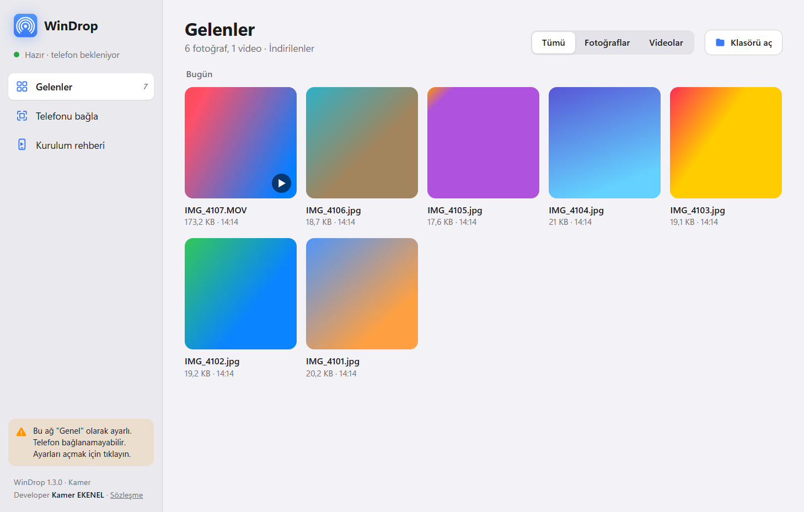
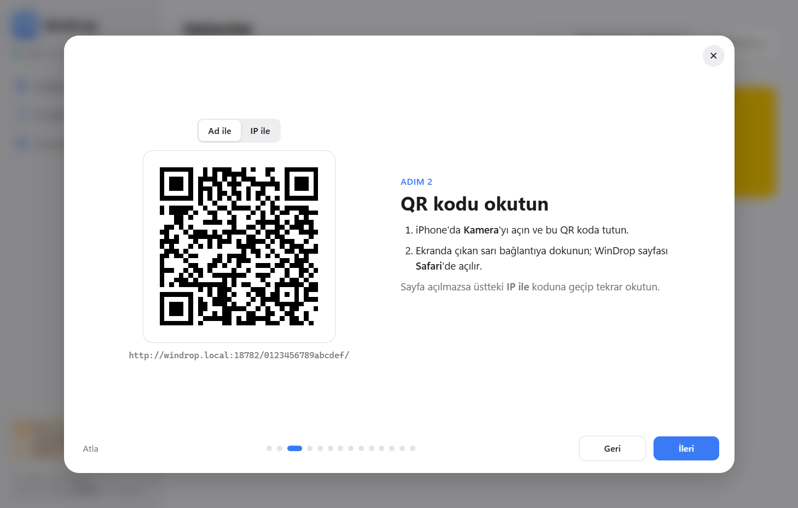
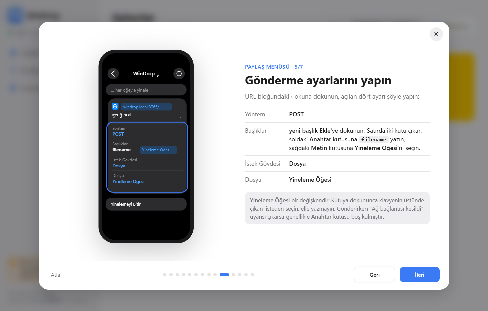

# WinDrop

WinDrop, iPhone'daki fotoğraf ve videoları ev ağı üzerinden Windows bilgisayara gönderir. Fotoğraflar uygulamasında dosyaları seçip Paylaş menüsünden WinDrop'a dokunduğunuzda dosyalar birkaç saniye içinde bilgisayarın İndirilenler klasörüne iner. Bulut hesabı ya da kablo gerekmez, iPhone'a da uygulama kurmanız gerekmez. Telefon tarafında Safari'de açılan bir sayfa ve Apple'ın Kestirmeler uygulaması kullanılır.



## İndirme

Kurulum dosyası [Releases](../../releases/latest) sayfasındadır: `WinDrop-Kurulum-<sürüm>.exe`. Dosyayı indirip çalıştırmanız yeterli; Node.js veya başka bir araç kurmanıza gerek yok.

Program dijital imzalı olmadığı için Windows ilk açılışta "Bilgisayarınız korundu" uyarısı gösterebilir. Bu durumda **Ek bilgi**'ye, ardından **Yine de çalıştır**'a tıklayın.

## Neler yapabilir

- Fotoğraflar'daki Paylaş menüsünden birden fazla fotoğraf ve videoyu tek seferde gönderir. iPhone videoyu küçültmeden gönderdiğinde dosya bilgisayara da aynı boyutta gelir.
- Ana ekrana eklenen WinDrop sayfasından dosya seçip gönderebilirsiniz. Bağlantı koparsa gönderim kaldığı yerden devam eder; büyük videolar da yarım kalmaz.
- Bilgisayardaki pencerenin Gelenler bölümünde dosyalar güne göre küçük resimlerle listelenir. HEIC fotoğraflar da önizlenir, videolar program içinde oynatılabilir.
- Her gönderimden sonra önizlemeli bir Windows bildirimi gelir. Bildirime tıklarsanız klasör açılır.
- Aynı adlı bir dosya varsa üstüne yazmaz, yeni dosyayı `ad (2).uzantı` olarak kaydeder. Aynı dosyayı ikinci kez gönderirseniz yeni bir kopya oluşturmaz.
- İlk açılışta kaydırmalı bir rehber açılır. Rehber, QR kodu ve iPhone'da yapılacakları ekran çizimleriyle adım adım gösterir.
- Pencereyi kapattığınızda program bildirim alanına iner ve dosya almaya devam eder. Kurulumda seçtiyseniz Windows açılınca arka planda kendiliğinden başlar.

| İlk açılış rehberi | Kestirme kurulumu |
| --- | --- |
|  |  |

## Gereksinimler

- Windows 10 veya Windows 11, 64 bit.
- Microsoft Edge WebView2. Windows 11'de hazır gelir. Eksikse kurulum sihirbazı indirme sayfasını açmayı önerir.
- iPhone. Gönderim sayfası Safari ile çalışır, Paylaş menüsü için Kestirmeler uygulaması gerekir. iOS 27 ile denenmiştir.
- iPhone ile bilgisayar aynı Wi-Fi ağında olmalı. Windows'ta bu ağın profili **Özel** olmalıdır (Ayarlar > Ağ ve İnternet > Wi-Fi > ağınız > Ağ profili türü). Ağ Genel olarak ayarlıysa WinDrop uyarı gösterir. Misafir ağları ve bazı iş ağları cihazların birbirini görmesine izin vermez.
- Telefonu "Ad ile" QR koduyla eklerseniz adres her Wi-Fi ağında çalışır; telefon ile bilgisayarın aynı ağda olması yeterlidir. "IP ile" eklenen adres yalnızca eklendiği ağda geçerlidir.

Yönetici hesabı gerekmez. Program yalnızca sizin kullanıcınıza kurulur. Güvenlik duvarı izni eklemek isterseniz Windows bir kez onay ister.

## Kurulum ve ilk kullanım

1. Kurulum dosyasını çalıştırın ve sözleşmeyi kabul edin. Masaüstü kısayolu, Windows açılışında başlatma ve güvenlik duvarı izni varsayılan olarak seçilidir.
2. Kurulum bitince WinDrop kendi penceresinde açılır ve rehberi gösterir.
3. iPhone'un kamerasıyla rehberdeki QR kodu okutun. Sayfa Safari'de açılınca **Paylaş > Ana Ekrana Ekle** ile ana ekrana ekleyin.
4. Paylaş menüsünde WinDrop'u görmek için rehberdeki yedi kestirme adımını izleyin. Bunu her iPhone'da bir kez yapmanız yeterli.
5. Gönderirken Paylaş ekranının üstündeki **Seçenekler > Biçim > Şu Anki** seçili olsun. Otomatik seçeneği videoları küçültebilir.

Kestirmedeki "URL İçeriğini Al" bloğunun Başlıklar bölümünde soldaki **Anahtar** kutusuna `filename` yazılmalı, sağdaki **Metin** kutusunda **Yineleme Öğesi** seçilmeli. Anahtar boş kalırsa iPhone "Ağ bağlantısı kesildi" der ve WinDrop bilgisayarda bunu bildiren bir uyarı gösterir.

## Kaldırma

**Ayarlar > Uygulamalar > Yüklü uygulamalar > WinDrop > Kaldır**. Kaldırırken ayarların da silinip silinmeyeceği sorulur. Gelen fotoğraf ve videolarınız silinmez.

## Gizlilik ve güvenlik

Dosyalar yalnızca yerel ağ üzerinden gider. WinDrop internete dosya ya da veri göndermez, kullanım bilgisi toplamaz. Ayarlar, gelen dosyaların listesi ve günlük `%LOCALAPPDATA%\WinDrop\data` klasöründe durur.

Telefonun bağlandığı adres, bilgisayara özel 16 haneli bir eşleşme kodu içerir. Kod kurulumda bir kez rastgele üretilir ve sonra değişmez. Ayar dosyasında, bu dosyanın yedeğinde ve Windows kayıt defterinde saklanır; ayar dosyası okunamazsa WinDrop yeni kod üretmek yerine yedeği kullanır. Kodu programdaki Telefonu bağla bölümünde görebilirsiniz. Bu kodu bilmeyen bir cihaz dosya gönderemez. Sunucu yalnızca özel ağ adreslerinden gelen istekleri kabul eder. Bilgisayardaki pencere yalnızca o bilgisayardan açılabilir.

Bağlantı HTTP ile kurulur ve şifrelenmez. iOS, yerel ağdaki bir bilgisayar için güvenilir sertifika kurmayı zorlaştırdığı için bu tercih edildi. WinDrop'u ev ağı gibi güvendiğiniz ağlarda kullanın.

## Bilinen sınırlar

- Program imzasız olduğu için Windows SmartScreen uyarısı çıkar. Bazı antivirüs programları az bilinen imzasız dosyalar için yanlış alarm verebilir.
- Paylaş menüsünden gönderilen dosyanın adında Türkçe karakter varsa (örneğin "ı"), iOS adı o harfte keser. Dosyanın içeriği eksiksiz gelir, yalnızca adı kısalır. Kamera fotoğraflarının adları (IMG_1234 gibi) etkilenmez.
- Yalnızca Windows'ta çalışır. Mac için bir sürüm yok.

## Nasıl çalışır

WinDrop üç parçadan oluşur:

- `windrop-server.exe`: Yerel ağda dosyaları alan HTTP sunucusu. Yalnızca Node.js'in standart kütüphanesiyle yazıldı, çalışırken npm paketi kullanmaz. Node.js'in tek dosyalık uygulama özelliğiyle (SEA) arayüz sayfalarıyla birlikte tek bir exe'ye gömülür.
- `WinDrop.exe`: Bildirim alanı simgesi ve program penceresi. C# ile yazıldı. Windows'ta hazır gelen .NET Framework derleyicisiyle derlenir, arayüzü WebView2 içinde gösterir. HEIC ve video küçük resimlerini Windows'un kendi küçük resim sisteminden alır. Sunucuyu başlatır, kapanırsa yeniden açar.
- Kurulum sihirbazı: Inno Setup ile hazırlanır.

Sayfadan yapılan gönderimlerde dosya 8 MB'lık parçalar halinde yollanır. Her parça CRC32 ile doğrulanır. Bağlantı koptuğunda telefon sunucuya dosyanın ne kadarının geldiğini sorar ve oradan devam eder. Paylaş menüsü ise dosyayı tek istekte gönderir; sunucu akışı doğrudan diske yazar, istek yarım kalırsa geçici dosyayı siler.

Bilgisayar ağda `windrop.local` adıyla bulunur. Bu adı WinDrop'un kendi mDNS yanıtlayıcısı duyurur. Aynı ağda başka bir WinDrop bu adı zaten kullanıyorsa ikinci bilgisayar `windrop-<bilgisayar-adı>.local` adını alır.

## Geliştirme

Gerekenler:

- Node.js 22 veya üstü
- Windows 10 ya da 11
- Kurulum dosyası üretmek için ayrıca [Inno Setup 6](https://jrsoftware.org/isinfo.php)

```powershell
# testler (geçici klasör ve rastgele port kullanır, İndirilenler'e yazmaz)
node --test

# sunucuyu kaynaktan çalıştırma (ayarlar proje içindeki data/ klasörüne yazılır)
node src/server.js

# kurulum dosyasını üretme: dist\WinDrop-Kurulum-<sürüm>.exe
powershell -ExecutionPolicy Bypass -File build\build.ps1 -TestEt
```

Derleme betiği önce sunucuyu tek dosyada toplar ve `node.exe`'nin bir kopyasına gömer. Bu adımda `postject` ve `rcedit` npm'den indirilir; ikisi de yalnızca derlemede kullanılır. Ardından WebView2 SDK'sını NuGet'ten indirir ve `WinDrop.exe`'yi derler. `-TestEt` verilirse testleri bu kez kaynak koda değil, oluşan exe'ye karşı çalıştırır. En son kurulum sihirbazını üretir.

| Klasör | İçerik |
| --- | --- |
| `src/` | Sunucu (`server.js`), QR kodlayıcı, mDNS yanıtlayıcı, Windows bildirimleri |
| `public/` | Telefondaki gönderme sayfası (`send.html`) ve program penceresinin arayüzü (`panel.html`) |
| `app/` | Program penceresi ve bildirim alanı (C#) |
| `installer/` | Inno Setup betiği ve kullanıcı sözleşmesi |
| `build/` | Derleme betikleri |
| `test/` | `node --test` ile çalışan testler |
| `tray.ps1`, `kur.ps1` | Kurulum dosyası olmadan, kaynaktan çalıştırmak için PowerShell'li geliştirme sürümü |

Pencereyi denemek için `WinDrop.exe /capture <dosya.png> /hash rehber=3` komutu çalışan sunucuya bağlanır, ekran görüntüsünü kaydeder ve kapanır. `/port` ve `/dest` ile başka bir sunucuya bağlanabilir.

## Katkı

Hata bildirimlerini ve önerileri [Issues](../../issues) bölümüne yazabilirsiniz. Kod göndermek isterseniz bir pull request açın. Göndermeden önce `node --test` çalıştırın; değişiklik telefon tarafını etkiliyorsa gerçek bir iPhone'la deneyin.

## Lisans

[MIT](LICENSE) © 2026 Kamer EKENEL. Kurulum dosyası, kendi lisanslarıyla dağıtılan Node.js'i (MIT) ve Microsoft Edge WebView2 bileşenlerini içerir. Lisans metinleri program klasöründeki `lisanslar` klasöründedir.

iPhone, iOS, Safari ve Kestirmeler Apple Inc.'in, Windows ve WebView2 Microsoft Corporation'ın ticari markalarıdır. WinDrop'un bu şirketlerle bir bağlantısı yoktur.

## English

WinDrop sends photos and videos from an iPhone to a Windows PC over the local network. Select files in Photos, tap Share and choose WinDrop; they land in the PC's Downloads folder. No cloud and no iPhone app are needed: the phone side uses a Safari page and an Apple Shortcuts shortcut. The interface is in Turkish. Download the installer from [Releases](../../releases/latest). MIT licensed.
